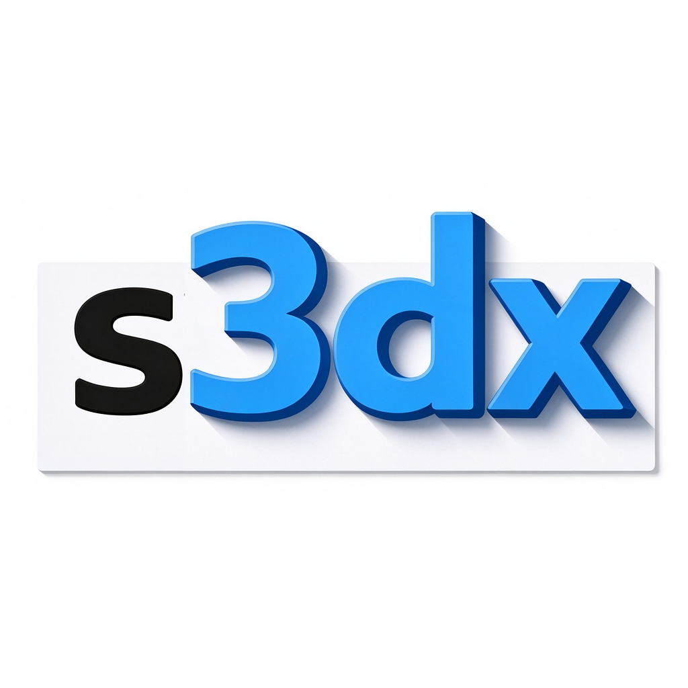

<p align="center">
  
</p>

<p align="center">
  
</p>

# svg3dx

[中文](README.zh-CN.md) | English

**svg3dx** is an open, XML-based format for parametric 3D geometry that extends SVG rather than replacing it. It keeps SVG's element structure, namespace model, and CSS-based styling, and adds a thin, well-defined layer for 3D primitives, parameters, logic, and display configuration.

Namespace prefix: `s3dx` · Draft URI: `urn:s3dx:draft:0.1`

## What it solves

Existing parametric CAD formats (Revit families, Glodon component editors, vendor-specific parametrics) are closed and tied to proprietary kernels. Generic mesh formats (STL, OBJ, GLB) store static results with no notion of a "recipe." svg3dx fills the gap: a **human-readable, kernel-agnostic recipe format** that describes *how* geometry is parameterized, not just *what* the final shape is.

## Core design

- **SVG-compatible by construction.** 3D elements live in a custom namespace (`urn:s3dx:draft:0.1`). Standard SVG renderers ignore them and continue to render any 2D content. A single `svg3d="true"` switch on the root enables 3D semantics.
- **Parameters via CSS custom properties.** A simplified subset of CSS (class selectors + inline custom properties) carries parameters. Expressions reference them as `[name]` or `var(--name)`. External parameters override everything, without mutating the DOM.
- **Logic through structure, not syntax.** Conditions attach to `<g>` (`if` / `ifnot`). Loops are dedicated elements (`s3dx:loop-points`, `s3dx:loop-range`). Boolean operations are elements (`s3dx:bool-union` / `subtract` / `intersect`) with closed, order-based scoping.
- **Kernel-agnostic.** The format describes geometry operations; evaluation is delegated to a backend (Open CASCADE, Manifold, etc.). The spec does not prescribe numerical precision.
- **Display configuration, not cameras.** `<s3dx:model>` declares render mode (`solid` / `wireframe` / `hidden-line`) and which geometry to show. Viewpoint and projection are left to the host.

## Status

Draft 0.1, internal. Namespace URI `urn:s3dx:draft:0.1` is provisional. Per-primitive attribute tables are being filled in incrementally and do not affect the core syntax.

## Repository layout

```
svg3dx/
├── assets/                 # Logo and title artwork
├── docs/                   # Format specification
│   └── svg3dx-spec-draft-0.1.md
├── samples/                # Example .svg files
│   └── draft-0.1-example.svg
├── licenses/               # Full license texts
│   ├── MIT.txt
│   └── MulanPSL-2.0.txt
├── LICENSE                 # Dual-license notice
├── README.md
└── README.zh-CN.md
```

## Documentation

- Format specification (draft 0.1): [`docs/svg3dx-spec-draft-0.1.md`](docs/svg3dx-spec-draft-0.1.md)
- Sample file: [`samples/draft-0.1-example.svg`](samples/draft-0.1-example.svg)

## Goals

- A common, open format for parametric 3D components that any vendor or tool can implement.
- Full 2D SVG fallback: a file without 3D content remains a valid SVG.
- Human-authorable, machine-verifiable, and diff-friendly.
- An ecosystem of independent evaluators rather than a single reference implementation.

## Non-goals (v0.1)

- Defining a 3D viewport or camera model.
- Prescribing a geometry kernel or evaluation algorithm.
- Replacing IFC; svg3dx is positioned as a parametric "recipe" layer that can compile to IFC or other exchange formats.

## Author

danny许

## License

Copyright (c) 2026 danny许

Dual-licensed under **MIT** and **木兰宽松许可证第2版 (MulanPSL-2.0)**. You may choose either license.

- [LICENSE](LICENSE) — dual-license notice
- [licenses/MIT.txt](licenses/MIT.txt)
- [licenses/MulanPSL-2.0.txt](licenses/MulanPSL-2.0.txt)
